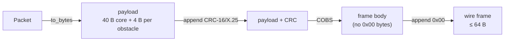

# aeropacket

Compact binary telemetry for landing zones (LZ) and drop zones (DZ), built for radio links where every byte costs airtime: LoRa, VHF/UHF audio modems, 2.4 kbps channels.

A full report (zone position, surface wind, drift, pressure, temperature, surface type and up to five obstacles) fits in one **64-byte** frame, CRC included.

- `#![no_std]`, no heap allocation, no `unsafe`. The core builds for bare-metal Cortex-M (`thumbv7em-none-eabihf`).
- Fixed-point fields only, so every platform produces the same bytes.
- CRC-16/X.25 on every frame and COBS framing, so a receiver can find frame boundaries in a raw byte stream and resync after noise.
- A streaming `FrameReader` that takes one byte at a time, small enough for a UART interrupt.

## Contents

- [Quick start](#quick-start)
- [Wire format](#wire-format)
- [Receiving a stream](#receiving-a-stream)
- [Command-line tool](#command-line-tool)
- [Errors](#errors)
- [Cargo features](#cargo-features)
- [Testing](#testing)
- [Project layout](#project-layout)
- [License](#license)

## Quick start

```toml
[dependencies]
aeropacket = { git = "https://github.com/JFrusher/AeroPacket" }

# Bare metal: drop serde and the CLI.
# aeropacket = { git = "https://github.com/JFrusher/AeroPacket", default-features = false }
```

```rust
use aeropacket::{codec, packet::status, Obstacle, ObstacleType, Packet, SurfaceCondition};

let mut packet = Packet {
    packet_id: 1,
    source_node: 7,
    status_flags: status::POSITION_VALID | status::ZONE_MARKED,
    target_lat: -339_123_456, // degrees × 10^7
    target_lon: 1_512_345_678,
    surface_wind_dir: 200,    // 0–255 maps to 0–360°
    surface_wind_spd: 12,     // knots
    baro_pressure_qnh: 10132, // tenths of hPa
    surface_condition: SurfaceCondition::DryGrass,
    obstacle_count: 1,
    ..Packet::default()
};
packet.obstacles[0] = Obstacle {
    distance_m: 120,
    bearing: 32,
    height_agl_m: 25,
    type_flag: ObstacleType::Tree,
};

// Encode: payload + CRC, COBS-stuffed, terminated by 0x00.
let mut frame = [0u8; codec::MAX_FRAME_LEN];
let len = codec::encode_frame(&packet, &mut frame)?;

// Decode one frame body (delimiter stripped).
let decoded = codec::decode_frame(&frame[..len - 1])?;
assert_eq!(decoded, packet);
# Ok::<(), aeropacket::AeropacketError>(())
```

## Wire format



All multi-byte fields are little-endian.

| Part | Size | Contents |
| --- | ---: | --- |
| Header | 6 B | packet id, source node, timestamp, status flags |
| Spatial core | 16 B | lat/lon (degrees × 10⁷), altitude (cm), LZ radius, ground slope, 4 reserved |
| Atmospheric & drift | 10 B | surface wind, gusts, MEW drift vector, QNH, air temperature, surface condition, 1 reserved |
| Hazards & approach | 8 B | primary heading, obstacle count, tallest obstacle, 5 reserved |
| Obstacles | 0–20 B | 0–5 records × 4 B: distance, bearing, height AGL, type |
| CRC | 2 B | CRC-16/X.25 over the payload |
| COBS overhead | 1 B | |
| Delimiter | 1 B | `0x00` |

A packet with five obstacles fills exactly 64 bytes. The crate checks this limit at compile time (`codec::MAX_FRAME_LEN`).

The byte-by-byte offset table lives in the [`packet` module docs](src/packet.rs) and nowhere else; a golden-bytes test pins it.

Angles (wind direction, drift direction, heading, obstacle bearing) use one byte per full turn: `0–255` maps to `0–360°`, about 1.4° per step.

> [!WARNING]
> The values for status flag bits, `SurfaceCondition` and `ObstacleType` are a first draft and have not been confirmed against operational requirements. The decoder rejects unknown values, so changing them after radios are deployed breaks compatibility.

## Receiving a stream

Feed raw bytes from the radio or UART into `FrameReader`. It splits the stream on `0x00`, decodes each frame and returns a result when a frame ends.

```rust
use aeropacket::codec::FrameReader;

let mut reader = FrameReader::new();

// e.g. inside a UART RX interrupt
fn on_byte(reader: &mut FrameReader, byte: u8) {
    match reader.push(byte) {
        Some(Ok(packet)) => { /* hand off the packet */ }
        Some(Err(err))   => { /* corrupted frame: count it, carry on */ }
        None             => { /* mid-frame or idle line */ }
    }
}
```

The reader uses a fixed 63-byte buffer. If the receiver starts mid-transmission, or noise corrupts a frame, that one frame comes back as an error and the reader picks up cleanly at the next delimiter. Repeated `0x00` bytes on an idle line produce nothing.

> [!NOTE]
> CRC-16 catches every single-bit error and every error burst up to 16 bits long, but about one random corruption in 65,536 passes the check. On a very noisy link that will happen eventually; validate packet contents at the application level if a false report would be dangerous.

## Command-line tool

The `aeropacket` binary converts between JSON in everyday units (degrees, metres, knots, hPa) and hex wire frames.

```console
$ cargo run -- encode examples/sample.json
060107100e2b010c63c9eb4e90245a9a1032040101010ac80c12c0099427120104400219010101010b78201901c8800f0240e100

$ cargo run -- decode 060107100e2b010c63c9eb4e90245a9a1032040101010ac80c12c0099427120104400219010101010b78201901c8800f0240e100
```

<details>
<summary>Decoded output</summary>

```json
{
  "packet_id": 1,
  "source_node": 7,
  "timestamp_sec": 3600,
  "status": ["position_valid", "wind_valid", "zone_marked", "brownout_risk"],
  "lat_deg": -33.9123456,
  "lon_deg": 151.2345678,
  "alt_m": 42.5,
  "lz_radius_m": 50,
  "ground_slope_pct": 4,
  "wind_dir_deg": 281.25,
  "wind_kt": 12,
  "gust_kt": 18,
  "mew_dir_deg": 270.0,
  "mew_kt": 9,
  "qnh_hpa": 1013.2,
  "air_temp_c": 18,
  "surface": "dry_grass",
  "primary_heading_deg": 90.0,
  "max_obstacle_ht_m": 25,
  "obstacles": [
    { "distance_m": 120, "bearing_deg": 45.0, "height_agl_m": 25, "type": "tree" },
    { "distance_m": 200, "bearing_deg": 180.0, "height_agl_m": 15, "type": "power_line" }
  ],
  "spatial_reserved": [0, 0, 0, 0],
  "atmos_reserved": 0,
  "reserved": [0, 0, 0, 0, 0]
}
```

</details>

Encoding rounds each value to the nearest wire step, so a decoded value can differ from the input by up to half a step (about 0.7° for angles). The reserved fields are optional on input and default to zero. `decode` always prints them, so decoding a frame and encoding the result gives back the same bytes.

## Errors

Every fallible call returns `Result<_, AeropacketError>`. Nothing in the encode or decode path panics on bad input.

| Variant | Cause |
| --- | --- |
| `InvalidChecksum` | CRC does not match the payload |
| `BufferTooShort` | input cut off, or output buffer too small |
| `MalformedObstacleData` | `obstacle_count` above 5 or not matching the records present |
| `InvalidSurfaceCondition(u8)` | unknown surface code |
| `InvalidObstacleType(u8)` | unknown obstacle code |
| `InvalidStatusFlags(u16)` | undefined status bits set |
| `InvalidFrame` | not valid COBS, contains `0x00`, or longer than a maximum frame |

## Cargo features

| Feature | Default | Adds |
| --- | :---: | --- |
| `std` | yes | serde derives on the enums, `serde_json`, and the CLI binary |

With `default-features = false` the crate depends only on `cobs` and `crc`, both used without `std`.

## Testing

```sh
cargo test                                                    # unit, CLI and link-emulation tests
cargo clippy --all-targets -- -D warnings
cargo build --lib --no-default-features --target thumbv7em-none-eabihf

# Fuzzing (nightly + cargo-fuzz)
cd fuzz && cargo +nightly fuzz run decode_frame -- -max_total_time=60
```

[`tests/link_sim.rs`](tests/link_sim.rs) emulates a noisy radio link. It sends thousands of random packets through a channel that flips bits, drops and inserts bytes, and powers up mid-frame, then checks that `FrameReader` delivers exactly the frames the noise left intact, in order, and nothing else.

The fuzz target feeds arbitrary bytes to `decode_frame`, `Packet::from_bytes` and `FrameReader`, and checks that anything which decodes encodes back to the same bytes.

## Project layout

| Path | Purpose |
| --- | --- |
| [`src/packet.rs`](src/packet.rs) | `Packet` model, enums, status flags, wire layout |
| [`src/codec.rs`](src/codec.rs) | CRC, COBS framing, `FrameReader` |
| [`src/error.rs`](src/error.rs) | `AeropacketError` |
| [`src/bin/cli.rs`](src/bin/cli.rs) | JSON ↔ hex command-line tool |
| [`examples/sample.json`](examples/sample.json) | Sample input for the CLI |
| [`tests/link_sim.rs`](tests/link_sim.rs) | Noisy-link emulation |
| [`fuzz/`](fuzz/) | cargo-fuzz target |

## License

Dual-licensed under MIT or Apache-2.0, at your option, as declared in [`Cargo.toml`](Cargo.toml).
